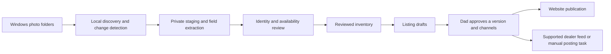

# SellMyCar inventory import, reconciliation, and publishing

Prepared 15 November 2026 against the website code in the sibling `qatar-drive-deal` folder. This plan and its standalone utilities live in **Dad Project Scripts** (`dad-project-scripts`). The dealership PC runs Windows. Its accounts are [QatarSale](https://qatarsale.com/en/showroom/sell_my_car_showroom) and [Qatar Living](https://www.qatarliving.com/en/vehicles/showrooms/sellmycar-1326).

## Project boundaries and current data

- **Qatar Drive Deal** is the website repository, designed/planned and built/published through Lovable, with Supabase as its cloud database. Website features, server-side integrations and database migrations belong there.
- **Dad Project Scripts** holds standalone/one-time PC utilities, discovery/import tools, OCR experiments, reconciliation tools, remote-access runbooks and their tests/documentation.
- The current website photos and advertisements are fake/sample data used to exercise the website and workflow. They are not evidence of the dealership's actual stock or historical sales. The schema review below describes code, not a verified deployed database or a completed production workflow.

## What is ready, and what is proposed

Implemented in this change: a local read-only, multi-root folder scanner, private JSON/CSV discovery reports, duplicate-copy candidates, unverified folder-name suggestions, and automated checks. See [running the scanner](../scripts/inventory/README.md).

The database extensions, authenticated upload, OCR, reconciliation UI, scheduled sync, approval queue, and marketplace integrations below are a concrete implementation plan. They are **not deployed or implemented** by the scanner. No production database, PC settings, platform listings, or source folders have been changed. Real drive paths and sample folders are still needed to configure and validate the first import. Remote setup also needs initial access on the Qatar PC.

## Fit with the existing website

The website already uses Supabase/Postgres and has:

- `vehicles` and `vehicle_images` for website listings;
- a dealer dashboard with draft, pending, active, reserved, sold and other listing statuses;
- a CSV/XLSX importer plus `vehicle_imports` and `vehicle_import_rows` for its audit trail;
- make/model/trim catalogue matching and seller authentication.

The current importer does not discover folders, upload their photos, extract registration-card fields, reconcile external adverts or deduplicate repeated runs. It requires make, model, year and price. Its missing-mileage handling turns an absent value into zero, so it is unsuitable for raw historical folder ingestion. The current dashboard also allows an owner to publish directly; a future mandatory approval workflow needs server/database enforcement, not just a new UI button.

The current `vehicles` schema requires year, price and other listing fields before insertion. Its policies allow public reads of sold listings as well as active/reserved listings. Therefore private historical stock and incomplete discoveries should enter separate, private staging/inventory tables first. Do not invent a price, mileage, or public listing merely to satisfy existing constraints.

## Daily workflow



He can keep his folder workflow. Once initial history is imported, a local scheduled task scans configured roots after he finishes editing, or a manual Sync button starts the same process. Newly discovered or changed content creates review work; record creation alone never publishes. The website stays available when the PC is off. Only local discovery waits for the PC and drives.

## Proposed database model

Keep ordinary inventory in relational Postgres tables and image bytes in object storage. Embeddings are optional later for similar-photo searches; they are unnecessary for identity, inventory counts, approvals or syncing. A vector match must never establish a sale or automatically merge cars.

All new tables below are private with seller-scoped access. Every row carries `seller_id`, timestamps and foreign keys enforcing same-seller relationships; a client-supplied seller ID is never an authorization decision.

| Table | Essential fields and constraints | Purpose |
| --- | --- | --- |
| `inventory_items` | UUID; seller; optional confirmed VIN and stock number; nullable verified make/model/year/trim, price, mileage; availability `unknown/in_stock/reserved/sold/archived`; `version`; confirmed dates; nullable website `vehicle_id` | Canonical physical car, even before it is publishable. Keep incomplete values null. Reviewed VIN uniqueness is seller-scoped and excludes blank/unknown values; VIN format/check rules must accommodate the actual market. |
| `inventory_sources` | UUID; seller; stable source ID; device; root path; last successful run; source availability | Multiple PC/external-drive roots. Drive letters can change without inventing a new collection. |
| `inventory_scan_runs` | UUID; source; start/end; status `running/complete/partial/failed`; manifest digest; counts; errors | Distinguishes an empty successful scan from a disconnected drive or partial scan. |
| `inventory_source_folders` | UUID; seller; source; relative path; scanner key; content fingerprint; nullable inventory item; first/last seen; review state; unique `(source_id, relative_path)` | Several folders can map to one car. Renames and copies require reconciliation. |
| `inventory_assets` | UUID; seller; folder; relative file path; SHA-256; size/mtime; kind `unreviewed/photo/document/other`; private object key; review/approval state | Resumable asset ingestion and privacy boundary. Same photo on two cars is evidence for review, not an automatic identity merge. |
| `inventory_field_observations` | UUID; item or unresolved folder; field name; candidate value; source kind/reference; observed time; confidence; reviewer decision | Keep competing folder, OCR, owner and marketplace facts instead of overwriting confirmed values. Minimize stored personal card data. |
| `inventory_channel_listings` | UUID; seller; item; channel; account identity; external ID/URL; observed status; last checked; last published version; unique `(seller_id, channel, account_id, external_id)` when external ID exists | One car's listing state on each platform. Multiple historical adverts are possible. Website listing maps to existing `vehicles`. |
| `inventory_listing_drafts` | UUID; item; version; title/description/features; selected approved photos; selected channels; canonical payload hash; state | Reviewable, immutable publication content. Channel-specific derivatives are retained under the approved version. |
| `inventory_publication_approvals` | UUID; draft version/hash; selected channels; approver; approved time; invalidation time | Approval is attached to exact content and destinations. A changed price, photo or description needs a new approval. |
| `inventory_publication_jobs` | UUID; item/draft/approval; channel; operation `create/update/unpublish`; state `queued/processing/succeeded/manual_action/failed/cancelled`; attempts; next attempt; lease expiry; idempotency key; external ID; result/error | Reliable delivery with per-channel outcomes, retries and manual fallback. |
| `inventory_status_events` | UUID; item; previous/new availability; source observation or owner action; actor/time | Auditable stock history. Store confirmed sold date and optional actual transaction price separately from advertised price. |

Use partial unique indexes for confirmed stock identifiers, uniqueness for per-version/channel/operation jobs, and indexes on seller/availability, source/folder, asset hash and queued-job due time. Confirm tenant ownership through composite foreign keys or trusted server functions, including linked assets, folders, approvals and jobs. Enable RLS on every private table; deny anonymous access; limit device access to staging. Public readers receive only approved listing projections.

## First bulk import

1. **Discovery:** configure all real roots, including offline external drives; scan locally without uploads. Start with 10–20 representative vehicle folders covering Arabic names, edits, duplicate backups, multiple identical models, old history and registration cards. Review the report before scanning all drives. A configured root is one level above vehicle folders; yearly grouping folders need separate roots.
2. **Identity:** assign an inventory UUID after review. Prefer verified VIN/chassis number, then a verified dealership stock ID. Record external listing IDs as channel identities. Make/model/year and similar images only propose matches. Flag conflicting VINs or one folder apparently containing several vehicles. A copied folder must not become a second car merely because its path differs.
3. **Extraction:** parse folder text first. OCR likely registration documents locally using Arabic and English models, then parse candidate fields. Verify against actual Qatar cards: model year, registration date and expiry date must remain distinct. Let conflicting or illegible fields stay unknown. OCR should run when useful details are missing or conflicting, rather than for every photo.
4. **Private documents:** keep mulkiya files and raw OCR out of the public `vehicle-photos` bucket and public listing tables. Filename detection alone is inadequate; every selected public photo needs document/privacy review. Extract only needed vehicle fields; do not send full owner details to a text-generation service. Originals remain on the PC unless a private backup is explicitly configured.
5. **Marketplace observations:** import the dealership's own account exports, owner-provided adverts, or a supported integration. Once platform permission/capability is established, an adapter can page through that seller's complete inventory with caching and rate limits. Store source account, external ID, URL, timestamp and completeness. Avoid crawling unrelated sellers.
6. **Availability reconciliation:** compare evidence and ask Dad to resolve unknowns/conflicts. Import historical folders into private history even if no price or description is available. Never mark all folders absent from current marketplace results sold.
7. **Website drafts:** project only sufficiently complete reviewed stock into existing website `vehicles` as drafts. Use a transaction to record source-to-item mapping, projection and audit state. The upload endpoint validates ownership, payload version, catalogue values, and explicit null handling. Do not use the existing CSV uploader for raw scanner reports.

Uploads should be resumable and idempotent using manifest/source keys and content hashes. Persist per-file upload receipts and per-folder processing results so interruption does not create repeated vehicles or duplicate public media. Root paths and stable device IDs stay private. Support Unicode paths and the actual mix of JPEG/PNG/HEIC/PDF before a full import; convert approved listing images into website-supported formats and strip EXIF before publishing.

## Live, sold, archived, and conflicting evidence

| Evidence | Initial result |
| --- | --- |
| An advert is live on one site | Store `live` for that channel and propose in-stock; Dad confirms the physical stock. |
| Advert disappears or expires | Mark channel `unknown/expired/removed` only when evidence supports it; vehicle availability is unchanged. |
| One platform says sold but another remains live | Flag conflict; confirm identity and the sale before changing stock, then prepare removals for remaining adverts. |
| A drive is disconnected or a folder is renamed | Record source availability/identity review; no sale, deletion or unpublishing. |
| Dad confirms a sale | Set inventory sold, record date, and enqueue unpublish/sold updates for every channel. Show unresolved removals until acknowledged. |
| Old folder has no matching advert or confirmed outcome | Retain as unknown or explicitly archived after review, without inventing a sale. |

Live stock count is the count of distinct confirmed `in_stock` inventory items, with reserved reported separately. Channel counts count adverts. Do not sum QatarSale and Qatar Living counts because they overlap. A complete reconciliation report shows confirmed stock, unknown folders, matched listings, unmatched listings, conflicts and coverage gaps.

Historical analytics can report confirmed sales and advertised-price history separately. A sold label plus asking price is not evidence of sale proceeds or margin. Preserve missing sold dates and transaction prices as null.

## Descriptions, features, and historical policy

- Reuse descriptions from the dealership's own correctly matched adverts where the account/export allows it; retain attribution and snapshot date internally. Do not copy another seller's content or apply a description to a different car sharing make/model/year.
- Draft descriptions from verified fields, optionally in English and Arabic. Generate feature lists only from confirmed trim/equipment, verified source adverts or Dad's review. Do not infer actual optional equipment from generic model knowledge or claim accident-free, warranty, service history, origin or mileage without evidence.
- Start by generating drafts only for confirmed current stock. Preserve historic descriptions if available. Skip new descriptions for sold, archived or unknown historical records by default. An optional history cutoff should use a confirmed sold/last-listed date, never model year or filesystem modification time. The cutoff remains a business preference to choose after discovery.
- Keep generated content distinct from approved content, including the confirmed facts used and the draft version. Generating text does not approve or publish it.

## Approval and delivery

Record creation emits a staging/review event. Once identity, availability, required sale fields and public photos are reviewed, the system prepares a versioned listing draft. Dad sees the price, description, features, images and intended platforms before approving.

Approval and job creation happen in one database transaction. Workers claim due jobs using database locks/leases, recheck the approved payload hash, the current item version and availability, then call a channel adapter. Editing or selling a vehicle cancels stale create/update jobs. A sale-removal job uses the existing channel mapping, has priority, and does not need to regenerate sales copy.

Each adapter returns its external ID, URL, exact result and state. Use the provider's idempotency support if offered; when a timeout leaves creation uncertain, reconcile by a stable external reference before retrying, or mark for manual verification. Do not promise exactly-once delivery to an API with no deduplication support. Retry transient errors with bounded backoff; credential/capability failures become visible tasks. A successful website publish does not imply the other two platforms succeeded.

Initial destinations:

- **Own website:** supported internally; project approved fields/photos to `vehicles`/`vehicle_images`, and enforce approval for synced listings at the database/server boundary.
- **QatarSale / Qatar Living:** adapters remain manual until supported dealer API/feed access or appropriate permission is confirmed. Produce a copyable title, description, verified specifications, selected approved photos, destination link, and a task to record the resulting external URL/ID. Updating and removing adverts need the same coverage as creation.
- **Notifications:** create in-app review and posting tasks first. Any email/WhatsApp delivery needs a chosen provider, account and destination; no messages have been sent or scheduled.

Do not call marketplace APIs directly from a database trigger. The trigger/transaction writes a durable outbox job, and a separately authenticated worker handles network calls and failures. Keep credentials server-side. The PC receives a device-scoped staging credential or authenticated seller session, never the unrestricted Supabase service-role secret. Protect persistent local credentials with Windows facilities and support revocation.

## Ongoing Windows sync

The first run and later runs use the same ingestion contract. A local scheduled task compares source/file metadata and content hashes, uploading only new/changed private assets; periodic full reconciliation catches missed events. The delivered scanner currently rehashes every supported file and has no upload/cache/watcher; that incrementality belongs to the next implementation.

Wait for files to settle, debounce folder edits, and allow Dad to mark a folder ready. Schedule a scan after login or at a chosen interval with an overlap lock, and skip unavailable roots without tombstoning existing records. Windows drive letters, locked files, long paths, interrupted copies, sleep, logout and external-drive disconnection need explicit diagnostics. A watcher is an optimization, not the sole source of change detection.

The local scheduler handles repeat runs; it does not require this Codex chat to remain open or an SSH session to stay connected. A dashboard shows last successful sync, offline sources, pending reviews, publication failures and external removal tasks.

## Windows remote access runbook

Use native Windows OpenSSH over Tailscale. Tailscale's own SSH server feature is distinct and currently does not support Windows as its server. Official references and limitations are recorded in [platform research](research/dealer-platform-integrations.md#remote-access-from-uae-to-a-windows-pc-in-qatar).

These commands are a proposed runbook; none has been run on Dad's PC. Initial installation and key placement need someone with local administrative access there, or an already-working remote desktop session. SSH cannot establish itself on an inaccessible machine.

1. Install Tailscale on the Qatar PC and the UAE PC. Configure the private network so only your intended administrator/device can reach the Qatar PC's SSH port. Enable Windows unattended mode if access after logout is needed. Confirm the Qatar PC can stay powered and awake when you need it.
2. On the Qatar PC, use an elevated PowerShell session to install/start native OpenSSH:

   ```powershell
   Get-WindowsCapability -Online -Name OpenSSH.Server*
   # Run Add-WindowsCapability only if the capability is not installed.
   Add-WindowsCapability -Online -Name OpenSSH.Server~~~~0.0.1.0
   Start-Service sshd
   Set-Service -Name sshd -StartupType Automatic
   ```

3. Use a dedicated standard Windows account with read access to the inventory roots and write access to its own report/work directory. Keep installation/admin tasks separate from routine imports. Generate a passphrase-protected client key on the UAE PC with `ssh-keygen -t ed25519`; put only its **public** key into that Windows account's `.ssh\authorized_keys`. Follow Microsoft's ACL instructions in the linked key-management guide. An administrator account uses a different key file by default; do not assume the standard-account instructions apply to it.
4. Restrict the automatically created SSH firewall rule to the actual UAE Tailscale IPv4 address, after finding it on that PC with `tailscale ip -4`. Substitute the real address below and verify other inbound SSH rules do not grant broader access:

   ```powershell
   Set-NetFirewallRule -Name OpenSSH-Server-In-TCP -RemoteAddress '<UAE-PC-Tailscale-IPv4>'
   ```

   This proposed design needs no router port forwarding. Tailscale network policy and Windows firewall scope must both permit the intended connection.
5. Find the Qatar PC's address using `tailscale ip -4`. From the UAE PC run `ssh <windows-user>@<Qatar-PC-Tailscale-IPv4>`. Verify the host-key fingerprint with the Qatar PC, confirm key-based login works, then disable SSH password authentication if desired and restart `sshd`. Keep a local recovery path while checking the connection.
6. Verify the SSH account sees the actual external drives and can run a small discovery report. Install the local scheduled sync under the intended account only after that works. Tailscale/OpenSSH does not make a sleeping, powered-off or disconnected PC reachable; account permissions and mounted drives still apply.

## Delivery sequence and acceptance

1. **Discovery, now:** scanner and report ready; configure real roots and inspect a representative sample. Acceptance: no source changes, separate identical cars retained, duplicate backups flagged, missing drives visible, cards private.
2. **Private inventory:** implement the new seller-scoped schema, authenticated resumable ingestion, identity/availability review and local OCR tested on real card samples. Acceptance: rerun creates no duplicate items; missing values remain null; incomplete/unknown history is private; confirmed edits survive resync.
3. **Website publication:** implement draft generation, public-photo review, content-bound approval and queued website projections. Acceptance: nothing publishes before approval; changing approved content invalidates it; private cards never enter public storage; sold stock stops advertising.
4. **Platform reconciliation:** obtain platform-supported export/integration permissions, import account snapshots, and resolve actual stock with Dad. Acceptance: pagination/completeness and conflicts visible; absence never means sold; deduplicated stock counts verified against his stock list.
5. **Distribution and daily sync:** begin with manual posting tasks; enable supported APIs channel by channel. Acceptance: retries do not duplicate adverts, partial failures remain visible, edits and sale removals reach every channel or remain explicit manual tasks; local sync survives logout/restart with offline drives handled.

## Inputs still needed

- Actual inventory root paths and two or three representative folder names/layouts; approximate vehicle count, total media size, and a sample of the file formats.
- An initial local setup session on the Qatar PC; supported Windows version, account permissions and installed Python/Tailscale/OpenSSH status.
- Dad's confirmed current-stock list (or a first reconciliation session), dealer export/API availability, and any platform consent for automation.
- Preferred draft language(s), where Dad should approve, any historical-description cutoff, and which fields/photos can be public.
- The existing deployment's authorized database access when it is time to apply and test migrations; no production secrets are needed for discovery.

See [the research report](research/dealer-platform-integrations.md) for sourced platform, OCR and Windows-access findings.
